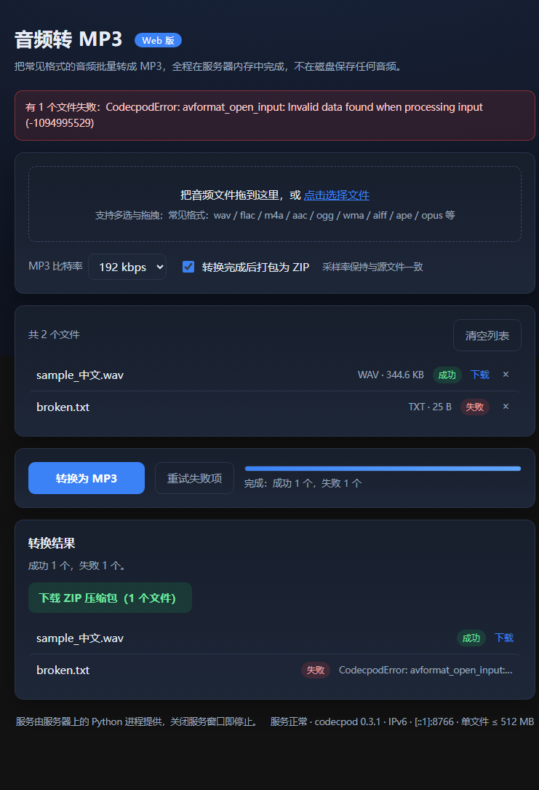

# 音频转 MP3 · Web 版

一个在 **Windows 上运行、用浏览器操作**的批量音频转 MP3 工具。
后端提供 HTTP API，前端为纯静态页面；**转换全程在内存中完成，服务端不向磁盘写入任何音频文件**。




---

## 目录

- [功能特性](#功能特性)
- [技术栈](#技术栈)
- [目录结构](#目录结构)
- [环境要求](#环境要求)
- [安装](#安装)
- [快速开始](#快速开始)
- [配置说明](#配置说明)
- [HTTP 接口](#http-接口)
- [使用示例](#使用示例)
- [测试](#测试)
- [部署](#部署)
- [设计约束：全程内存化](#设计约束全程内存化)
- [安全说明](#安全说明)
- [常见问题](#常见问题)
- [贡献指南](#贡献指南)
- [License](#license)

---

## 功能特性

- **批量转换**：一次拖入多个音频文件，逐个转换并显示各自状态。
- **多格式输入**：支持 21 种常见音频扩展名（见 [配置说明](#配置说明)）。
- **4 档比特率**：128 / 192 / 256 / 320 kbps，采样率与源文件一致。
- **ZIP 打包下载**：转换完成后可在服务端内存中打包为 ZIP 一次性下载。
- **全程内存化**：输入、解码后的 PCM、输出 MP3、ZIP 均不落盘（见 [设计约束](#设计约束全程内存化)）。
- **中文文件名**：上传与下载均正确处理中文名，不会乱码。
- **IPv4 / IPv6**：默认仅监听回环地址；支持 IPv6 与双栈对外访问。
- **访问令牌（可选）**：绑定非回环地址时强制要求令牌，也可显式关闭。
- **零前端依赖**：不使用任何 CDN，页面离线可用。
- **并发与内存保护**：并发闸门、请求体上限、解码后体积上限，避免大文件把内存打爆。

---

## 技术栈

| 层次 | 选型 | 说明 |
|---|---|---|
| 音频引擎 | [codecpod](https://pypi.org/project/codecpod/) | 静态链接 FFmpeg，**运行时无需另装 FFmpeg** |
| 数值处理 | numpy | 解码后的采样数据 |
| HTTP 服务 | Python 标准库 `http.server` | 刻意不引入 Flask / FastAPI，避免框架把上传体落盘 |
| 前端 | 原生 HTML / CSS / JavaScript | 无构建步骤、无外部依赖 |
| 打包/环境 | 内置 `build.py` | 创建 `.venv`、安装依赖（多镜像回退） |

---

## 目录结构

```
.
├── web_server.py            # 服务端：HTTP API、IPv4/IPv6 绑定、鉴权、内存化转换
├── web/                     # 前端（纯静态，零依赖）
│   ├── index.html
│   ├── style.css
│   └── app.js
├── start.py                 # 双击启动入口（关闭窗口即停止服务）
├── start_external.py        # 外网访问启动器（生成令牌 / 挑端口 / 列出公网 IPv6）
├── 启动Web版.bat             # Windows 启动脚本（依赖自检 + 自动补装）
├── build.py                 # 环境准备（python build.py --env-only）
├── requirements.txt         # 运行时 + 打包依赖
├── requirements-web.txt     # 仅 Web 运行所需依赖（精简）
├── scripts/
│   ├── firewall_ipv6.ps1    # 放行 IPv6 入站（需管理员手动执行）
│   └── verify_ipv6.ps1      # IPv6 就绪检查（只读，不改系统设置）
├── tests/
│   ├── run_tests.py         # 端到端验证（含 IPv6、鉴权、并发、内存化审计）
│   └── ui_test.js           # 浏览器端 UI 验证（CDP 驱动 Edge，无第三方依赖）
├── docs/
│   └── screenshot.png
├── 部署说明.md               # 详细部署文档（含公网 IPv6 章节）
├── .gitignore
└── .gitattributes
```

---

## 环境要求

| 项 | 要求 |
|---|---|
| 操作系统 | Windows 10 / 11 或 Windows Server 2016+（64 位） |
| Python | **3.10 – 3.13（64 位）**，需在 PATH 中 |
| FFmpeg | **不需要**（codecpod 已静态链接） |
| Node.js | 仅运行 `tests/ui_test.js` 时需要（可选） |
| 网络 | 仅首次安装依赖需要；之后可离线运行 |

> 本项目在 Python 3.13.12 + codecpod 0.3.1 + numpy 2.5.4 上验证通过。

---

## 安装

### 方式一：双击启动（会自动装依赖）

直接双击 `启动Web版.bat` 或 `start.py`。首次运行会自动创建 `.venv` 并安装依赖。

### 方式二：手动准备环境

```bat
python build.py --env-only
```

### 方式三：只装运行依赖

```bat
.venv\Scripts\python.exe -m pip install -r requirements-web.txt -i https://mirrors.aliyun.com/pypi/simple/
```

> **注意**：`codecpod` 较新，部分镜像（如清华 TUNA）可能尚未同步。请使用**阿里云**或**腾讯云**镜像。

---

## 快速开始

### 1. 本机使用（默认，最安全）

```bat
REM 双击启动，或：
start.py
```

浏览器打开 <http://127.0.0.1:8765/> 即可。关闭窗口即停止服务。

### 2. 命令行启动

```bat
.venv\Scripts\python.exe web_server.py --no-browser --port 8765
```

### 3. 仅监听本机

```bat
python start.py --local
```

### 4. 外网 / 局域网访问（需令牌）

```bat
python start.py --host 0.0.0.0 --port 38443 --token <你的令牌>
```

### 5. 公网 IPv6 访问

```bat
.venv\Scripts\python.exe start_external.py --port 38443
```

该启动器会自动准备令牌、挑选空闲端口、探测本机公网 IPv6 并打印可点击的访问地址，
同时给出防火墙放行命令。详见 [部署说明.md](部署说明.md) 的「公网 IPv6 外网访问」章节。

---

## 配置说明

命令行参数优先级高于环境变量。

| 命令行参数 | 环境变量 | 默认值 | 说明 |
|---|---|---|---|
| `--host` | `A2M_HOST` | `127.0.0.1` | 监听地址。支持 `127.0.0.1`、`localhost`、`0.0.0.0`、`::`（双栈）、`::1`、`[::1]`、`2409:...` |
| `--port` | `A2M_PORT` | `8765` | 监听端口；被占用时自动向后寻找空闲端口 |
| `--max-file-mb` | `A2M_MAX_FILE_MB` | `512` | 单文件（请求体）上限，MB |
| `--max-pcm-mb` | `A2M_MAX_PCM_MB` | `2048` | 解码后 PCM 上限，MB（默认 4× 单文件上限） |
| `--concurrency` | `A2M_CONCURRENCY` | `2` | 并发转换上限，超出立即返回 `503` |
| `--timeout` | `A2M_TIMEOUT` | `300` | 单请求读超时（秒） |
| `--token` | `A2M_TOKEN` | 无 | 访问令牌；**绑定非回环地址时必填** |
| `--allow-insecure` | `A2M_ALLOW_INSECURE=1` | 关 | 非回环且无令牌时，明确接受无保护暴露的风险 |
| `--allowed-origins` | `A2M_ALLOWED_ORIGINS` | 无 | 逗号分隔的 Origin 白名单 |
| `--no-browser` | — | 关 | 启动后不自动打开浏览器 |
| `--log-file` | `A2M_LOG_FILE` | 无 | 追加日志到文件（须位于项目目录内，不含音频数据） |

**支持的输入格式（21 种）**

```
wav  flac m4a  aac  ogg  oga  wma  aiff aif  mp3
ape  opus wv   ac3  alac mka  mp2  mp1  amr  caf  au
```

**支持的输出比特率**：`128` / `192` / `256` / `320` kbps（默认 `192`）

---

## HTTP 接口

| 方法 | 路径 | 说明 |
|---|---|---|
| GET | `/` | 前端页面 |
| GET | `/style.css` `/app.js` | 静态资源（仅限 `web/` 目录内，防路径穿越） |
| GET | `/api/health` | 健康检查：引擎版本、绑定信息、上限、是否要求令牌 |
| GET | `/api/formats` | 支持的输入格式与比特率 |
| POST | `/api/convert?bitrate=192&name=xxx.mp3` | 请求体 = 单个音频的原始字节；返回 `audio/mpeg` |
| POST | `/api/zip` | 请求体 = 自定义帧；返回 `application/zip` |

`/api/zip` 的自定义帧格式（大端序，与 `web/app.js` 约定一致）：

```
重复若干块：[u32 名称长度][名称 UTF-8][u32 数据长度][数据]
```

错误统一返回 JSON：`{"error": "..."}`

| 状态码 | 含义 |
|---|---|
| `400` | 参数错误 / 文件损坏 / 请求体为空 |
| `401` | 缺少或错误的访问令牌 |
| `403` | Origin 不在白名单内 / 路径穿越被拦截 |
| `413` | 解码后体积超过上限 |
| `503` | 并发已满（服务繁忙） |
| `507` | 服务器内存不足 |

---

## 使用示例

### 浏览器

打开页面 → 拖入文件（或点击选择）→ 选择比特率 → 点击「转换为 MP3」→ 逐个下载或下载 ZIP。

### curl

```bash
# 健康检查
curl http://127.0.0.1:8765/api/health

# 转换单个文件（输出保存为 out.mp3）
curl -X POST --data-binary "@input.wav" \
     "http://127.0.0.1:8765/api/convert?bitrate=192&name=input.wav" \
     -o out.mp3

# 需要令牌时
curl -H "X-Auth-Token: YOUR_TOKEN" http://127.0.0.1:8765/api/health

# IPv6 地址必须写成方括号形式
curl -g "http://[::1]:8765/api/health"
```

### Python

```python
import urllib.parse
import urllib.request

data = open("input.wav", "rb").read()
url = ("http://127.0.0.1:8765/api/convert?bitrate=192&name="
       + urllib.parse.quote("中文名.wav"))
resp = urllib.request.urlopen(urllib.request.Request(url, data=data, method="POST"))
open("out.mp3", "wb").write(resp.read())
```

---

## 测试

### 端到端测试（自带服务，无需手动启动）

```bat
.venv\Scripts\python.exe tests\run_tests.py
```

覆盖：内存化转换链路、健康检查与格式接口、4 档比特率、中文文件名、损坏文件、
请求体上限、ZIP 打包与防路径穿越、并发闸门、令牌鉴权、启动安全闸门、Origin 白名单、
地址判定单元测试、IPv6 绑定与双栈访问、内存化审计（转换期间临时目录必须为空）。

> 若本机不支持 IPv6 绑定，相关用例会被标记为 **SKIP**（不计为通过），并在结果中给出原因。

### 浏览器 UI 测试

需要先启动服务，并安装 Edge（路径可用环境变量 `A2M_EDGE` 覆盖）：

```bat
.venv\Scripts\python.exe web_server.py --no-browser --port 8765
node tests\ui_test.js
```

覆盖：页面无控制台报错、健康检查渲染、拖拽/多选上传、真实点击转换、
成功/失败统计、逐文件下载、ZIP 入口、按钮加载态、失败重试。

---

## 部署

部署到 Windows 服务器（含防火墙、公网 IPv6、反向代理、回滚）请阅读
**[部署说明.md](部署说明.md)**，其中包含：

- 启动脚本与命令行启动方式
- 全部配置项
- 公网 IPv6 外网访问（防火墙放行、来源前缀限制、光猫/路由检查、`curl -6` 验证）
- 反向代理 + HTTPS 的长期方案
- 回滚步骤与常见问题

`build.py` 也可以准备运行环境：

```bat
python build.py --env-only
```

> 说明：`build.py` 中面向「桌面版单文件 exe」的打包步骤依赖 `AudioToMP3.spec`，
> 本仓库为 **Web 版**，不包含该文件；完整打包路径会检测到缺失并给出提示后退出，
> 不影响 `--env-only` 的使用。

---

## 设计约束：全程内存化

这是本项目最关键的设计红线：

```
请求体 → bytes → codecpod.load(bytes) → numpy → codecpod.save_bytes(Mp3) → HTTP 响应
```

- 不使用 `tempfile`、磁盘缓存、上传落盘、转换落盘。
- ZIP 通过 `io.BytesIO` + `zipfile` 在内存中生成。
- 刻意不引入 Flask / FastAPI 等默认会把上传体 spool 到磁盘的框架。
- 出于内存保护，超大请求体会被拒绝；`--max-pcm-mb` 限制解码后的 PCM 体积。

> 音频仍以 HTTP 明文在网络上传输；跨机传输建议经反向代理启用 HTTPS。

---

## 安全说明

- **默认只监听 `127.0.0.1`**，仅本机可访问，这是最安全的默认值。
- **绑定非回环地址（如 `0.0.0.0`、`::`、公网 IP）时必须提供 `--token`**，否则服务会**拒绝启动**。
  如需无鉴权对外暴露，必须显式加 `--allow-insecure`，并自行承担风险。
- **IPv6 没有 NAT**：防火墙放行后，任何 IPv6 客户端都能直接访问，请务必使用令牌。
- 静态资源访问限制在 `web/` 目录内；ZIP 条目名会做去穿越处理。
- 可选 `--allowed-origins` 缓解 DNS rebinding。
- 建议的加固方式：保持回环监听 + 反向代理 + HTTPS；或仅放行可信来源前缀。
- 已启用令牌时，令牌保存在工作区内的 `.access_token`（已被 `.gitignore` 排除），**请勿分享该文件**；
  怀疑泄露时请立即轮换。

发现安全问题时，请勿在公开 Issue 中披露细节。

---

## 常见问题

| 现象 | 处理 |
|---|---|
| `No matching distribution found for codecpod` | 换用阿里云/腾讯云镜像；清华 TUNA 可能未同步 |
| `音频引擎加载失败：No module named 'codecpod'` | 双击 `启动Web版.bat`，或执行 `build.py --env-only` |
| 端口被占用 | 会自动后移端口，也可用 `--port` 指定 |
| 页面提示「需要访问令牌」/ `401` | 用 `http://host:port/?token=<令牌>` 访问一次，之后由 Cookie 保持 |
| 提示「服务器繁忙」/ `503` | 并发已满。稍后重试，或用 `--concurrency` 调大（注意内存） |
| 大文件报「解码后音频过大」 | 调大 `--max-pcm-mb`，或降低源文件规格 |
| IPv6 地址打不开 | 地址必须写成方括号 `http://[IPv6]:端口/`；并确认防火墙已放行 |
| 想停掉服务 | 关闭启动窗口，或在任务管理器结束对应的 `python.exe` |

---

## 贡献指南

1. Fork 本仓库并新建分支（例如 `feature/xxx`）。
2. 保持与现有代码风格一致；不要引入会把上传内容落盘的依赖。
3. 修改后请运行 `tests/run_tests.py`，确保通过（IPv6 用例在无 IPv6 环境下允许 SKIP）。
4. 提交前请确认没有把令牌、日志、临时文件、虚拟环境等提交进仓库。
5. 提交 Pull Request，并在描述中说明改动动机与验证方式。

---

## License

**License 未指定。**

本仓库当前未附带任何开源许可证文件。在补充许可证之前，默认保留所有权利；
如需以开源方式分发，请先添加合适的 LICENSE 文件（例如 MIT / Apache-2.0）。
